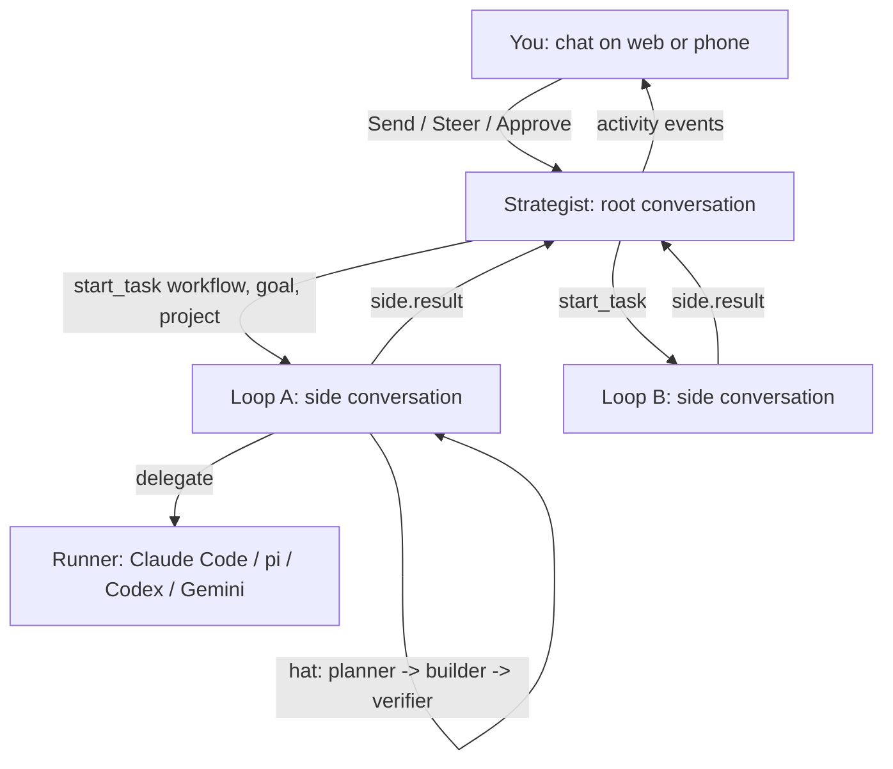

# Ralph v3: high-level design

Status: draft for Mikey's review. 2026-10-13.
Base: `docs/design/v3-on-icedrop.md` on `integration/v3-prerelease` (PR #386, merge commit `72012451`). This doc calls it "#386".

## Sources

| Short name | What | Pin |
|---|---|---|
| #386 | `docs/design/v3-on-icedrop.md` and `prototypes/v3-hat-seam/seam.mjs` | `integration/v3-prerelease` @ `72012451` |
| v2 study | `/workspace/research/ralph-v2-grounded-20261013.md` | `main` @ `1b10a76`, v2.10.1 |
| pd study | `/workspace/research/pi-durable-grounded-20261013.md` | `icedrop-labs/pi-durable` master @ `2b6ed91`, harness `@earendil-works/pi-durable` 1.1.0 |

Conventions:
- Code paths come from those three sources. A path marked **[checked]** I confirmed myself today.
- Each section ends with a verdict: **Agrees with #386**, **Changes #386**, or **New** (not covered by #386).
- Text marked **Opinion** is my judgment, not a fact about the code.

Version drift to know about: #386 read pi-durable at master `88f9fc38`. The pd study read `2b6ed91`. #386 says `docs/projects-v2.md` and `docs/steer-arbiter.md` do not exist. At `2b6ed91` both exist **[checked]**. `apps/server/src/side.ts` defines `side.origin`, `side.result`, and `side.merged` **[checked]**.

## 1. Goals

1. Built on pi-durable.
2. An interactive chat. You watch a task move through a workflow's hats.
3. An activity bar shows transitions, progress, and tool use.
4. Hat transitions are not tasks. A task is handed to a workflow. The workflow is one agent wearing many hats.
5. One strategic agent spawns parallel tactical Ralph-style loops.
6. Workflows and routing determine the roles.
7. Suited to frontier models. Less babysitting. The model declares completion with evidence, and a verifier checks it. Budgets are guardrails that ping the human, not hard caps.
8. Keep from v2: topic-tagged events, required events, guidance ack, presets as named bundles.
9. Add Codex and Gemini runners.

Non-goals:
- A new daemon, protocol, or SQLite file. (Agrees with #386.)
- The v2 web dashboard. (Agrees with #386.)
- Landing git branches inside the daemon. (Agrees with #386.)

## 2. Vocabulary

| Term | Meaning |
|---|---|
| Strategist | The root conversation. You talk to it. It plans, starts tasks, and reports. It wears no workflow hat. |
| Task | One goal handed to one workflow. It has one loop conversation and one outcome. |
| Workflow | A named set of hats, triggers, gates, budgets, and runner defaults. A preset is a workflow you can name. |
| Loop | The conversation that runs one task. It is a side conversation of the strategist. |
| Hat | A role inside a loop. Wearing it changes the loop's `instructions` section. |
| Transition | One hat handing off to the next by emitting a topic. It is a transcript entry, not a task. |
| Runner | What executes a hat's work: the app's own model, or a delegation to Claude Code, pi, Codex, or Gemini. |

## 3. Host: the icedrop pi-durable daemon

- Ralph v3 runs inside the existing pi-durable daemon (`apps/server`, bin `pi-durable-daemon`; pd study §1).
- One process owns storage. Storage is SQLite (WAL) under `~/.pi-durable` (pd study §3; `packages/agent/src/storage.ts:20-25`, `config.ts:161`).
- Every change is an atomic commit. Crash resume is `harness.resume()` on boot (`apps/server/src/daemon.ts:143`). Tools rerun after a crash only when declared `replay: "safe"` (pd study §4).
- Clients speak `POST /commands` and `GET /events` (SSE) (`daemon.ts:325-410`). MCP is `POST /mcp` (`apps/server/src/mcp.ts`).
- Rust keeps git coordination: worktrees, merge queue, loop lock (v2: `.ralph/merge-queue.jsonl`, `loop_lock.rs`). The hat path does not read those files.
- The v2 run path is not used by v3: `loop_runner.rs`, the in-memory `EventBus`, `.ralph/events-*.jsonl`, and `ralph emit` (v2 study §1-2).

**Agrees with #386.** Same host, same "no second store" rule, same Rust/daemon split. #386 lists what replaces the PR #381 hand-rolled pieces; that table stands.

## 4. Shape: one strategist, many loops



Rules:
- The strategist is the root conversation you already have open. It does not rotate hats.
- The strategist starts a task with a tool, `start_task({ workflow, goal, project })`. The tool forks a side conversation (the loop) and returns the task id.
- Each loop wears one hat at a time. Hat switches use #386's mechanics unchanged (section 5).
- Loops run in parallel. Each loop that edits code uses its own registered project. #386: "A parallel checkout is a second registered project." Rust lands the branch.
- A loop ends with one `side.result` to the strategist (`side.ts`, `RESULT_CHARS = 1500` **[checked]**). The full trail stays in the loop.

**Changes #386.** #386 puts hats on the root conversation. It lists "a loop is a side session, and hats rotate there" as a rejected alternative.

Why change:
- Goal 5 needs parallel loops. One root conversation can wear one hat at a time. Two tasks cannot share it.
- Goal 4 says a task is one agent wearing many hats. A loop conversation is that agent. The root is not.
- #386 itself names the upside of the side-loop shape: the root cache stays warm and each hat sees a focused transcript.

How this answers #386's objections:
- "Send and Steer on the thread they opened do not wear the hat." In v3 you steer a task, not the root. The chat addresses a loop by task (section 9). The steer lands in that loop with `whenBusy: "steer"`.
- "Each activation reconfigures model and tools inside the loop." Not by default. A root-placed hat inside a loop changes only `instructions`. That is #386's own cache rule, now applied per loop.
- "It adds a driver that interprets steps." v3 reuses #386's `onSettled`/`observe`. #386 already specifies `onSettled` for side conversations (its open question 2). No second driver.

Opinion: keep one rule. Every task runs in a loop, even when only one task exists. One code path is easier to test than "root unless parallel."

## 5. Hats inside a loop

Kept from #386 as specified:
- Wearing a hat is `configure({ instructions })` on the loop conversation.
- The hat speaks through one tool, `emit(topic, payload)`. The topic must be one of the worn hat's `publishes`. Success returns `{ control: { terminate: true } }`. The visit ends before the next hat's instructions apply.
- After the loop settles, `onSettled` calls `observe(rules, view)`. It returns one step. It applies that step and returns.
- The next hat wakes via a follow-up whose `requestId` is `wake:<emitEntryId>:<hatId>`. Repeated ids dedupe. #386's seam measured this, including after reopening the SQLite file.
- The worn hat is derived from the transcript by `ViewReader`. It is never parsed out of the instructions string.
- `Trigger` is a closed union: `human.goal`, an emit topic, `side.merged` (aggregate `all` or `first`), `delegation.done`, `schedule.fired`.
- Hats with `concurrency` 2-8, a tool ban, a cwd, or a model run as sides of the loop (`place: "side"`).
- No `onYield` or `afterTools` hook continues a run. Routing happens after settle.

**Agrees with #386** on all of the above, applied to the loop instead of the root.

Hat transitions are not tasks:
- A transition is a transcript entry: an `emit` tool result, then a wake. There is no task row per hat.
- A task is the loop. It has one durable record (section 6). It sees many transitions.
- v2 already treated hats this way. `next_hat()` returns `"ralph"` in multi-hat mode and "custom hats define topology only" (v2 study §3; `event_loop/mod.rs:892-901`).

**Agrees with #386** ("A hat is a visit... no job list"). **New**: the explicit task record that sits above the transitions.

## 6. Tasks

- A task record holds: `id`, `workflow`, `goal`, `project`, `loopConversationId`, `status` (`running`, `waiting_human`, `verifying`, `done`, `failed`, `aborted`), budget usage, evidence refs.
- It is derived from the loop transcript plus one document. Opinion: a `ralph.task` document via `defineDoc` (pd study §5, §7 "Tasks"), committed with the work.
- The strategist reads task records to answer "what is running?"
- A loop may keep a todo list for its own work. Opinion: a document in the loop, not v2's `.ralph/agent/tasks.jsonl`.

**New.** #386 has chains but no task record. v2 had runtime tasks (`ralph-core/src/task.rs:33`).

## 7. Workflows, presets, and routing

Two levels of routing:
1. **Strategist routes tasks to workflows.** It picks a workflow by name from the preset catalog when it calls `start_task`. You can also name it: "use site-change."
2. **Topics route hats inside a workflow.** That is #386's trigger union.

A preset is a named bundle:

```yaml
# Opinion: illustrative shape, not a committed schema.
name: code-assist
description: Plan, build, verify.
hats:
  planner:  { triggers: [human.goal], publishes: [plan.ready], instructions: "..." }
  builder:  { triggers: [plan.ready, verify.gaps], publishes: [build.done], runner: codex, instructions: "..." }
  reviewer: { triggers: [build.done], publishes: [review.done], concurrency: 3, instructions: "..." }
required_events: [build.done, review.done]
verifier: { mode: model+checks, checks: [tests_ran, no_open_todos] }
budgets: { soft: { usd: 5, minutes: 60, wakes: 40 }, hard: { usd: 20 } }
```

- Hat YAML stays the one authoring format. #386's `importHats`/`checkRules` compile it offline.
- The strategist sees the preset catalog. Loops do not. #386's reason holds inside loops: a catalog in the prompt asks the model to route.
- v2 presets live in `presets/*.yml` with `presets/index.json` (v2 study §9). Their hats import. Their loop caps map to budgets (section 8).

**Agrees with #386** on YAML as the format and topics as hat routing. **Changes #386** in three import rules:
- `backend` / `backend_args`: #386 makes them an import error. v3 maps them to `runner` (section 10).
- `max_iterations`, `max_runtime_seconds`, `max_cost_usd`: v3 maps them to soft budgets, not caps.
- Adds preset-level `required_events`, `verifier`, `budgets`, and `hooks` (for deploy steps; section 13).

## 8. Completion and budgets

### Completion: declare, show evidence, verify

1. The working hat calls `declare_complete({ summary, evidence, open_items })`. `evidence` is a list of refs: commands run and their output entries, files, URLs. The tool returns `terminate: true`.
2. On settle, `observe` sees the declaration and runs the **verify step**:
   - Mechanical gates. Every `required_events` topic was emitted in this task. Every guidance entry is acknowledged (section 9). `open_items` is empty or each item is marked deferred.
   - A verifier. Default: a verifier hat in a side of the loop with a cheap model and read-only tools. It returns `accept` or `gaps: [...]`. It may reuse the `runEnd` classifier pattern in `packages/agent/src/checks.ts:583-641` (pd study §8).
3. `accept`: the task is `done`. The loop posts `side.result` to the strategist.
4. `gaps`: one wake back to the declaring hat with the gaps as the wake text. Topic `verify.gaps`.
5. A second rejection in a row sets `waiting_human` and asks you.

Why after settle and not in `onYield`: the pd study (§9, "Direction") proposes `onYield`. #386 rejects hooks that continue a run. Its reason: a continue and a phone Steer share one inbox, and a configure mid-round reaches tool calls already issued. Opinion: #386 is right. Verifying after settle costs one extra run and keeps one routing path.

**Changes #386.** #386 completes on a `loop.complete` emit with no verification. v2 completes on `LOOP_COMPLETE` with gates but no verifier (`check_completion_event`, `event_loop/mod.rs:734-837`).

### Budgets: guardrails that ping you

- Measured: cost (`pi.usage` document), wall time, wake count, per-hat activations. Sources: pd study §3, #386 `maxActivations` and chain budget.
- **Soft threshold**: the loop keeps working. You get a push and an activity-bar warning. You can raise, keep, or stop.
- **Hard ceiling**: the loop pauses at the next settle and asks via the app's approvals (`packages/agent/src/approvals.ts`, `approve` command; pd study §5). It does not abort mid-tool.
- **Stuck**: the `stuck` decision check (`checks.ts:12-13`) replaces v2's `LoopStale` and `LoopThrashing`. A stuck signal pings you. It does not kill.
- Hitting `maxActivations` on a hat pings you. It does not go quiet.

**Changes #386.** #386: "Hitting the cap is `quiet`." Opinion: quiet is wrong for frontier models. A silent stop looks like a hang. A ping costs you one tap.
**Changes v2.** v2 terminates on `MaxIterations` (100), `MaxRuntime` (14400 s), `MaxCost` (v2 study §2). v2 issue #369 shows a completion masked by `max_iterations`. Ceilings that pause and ask avoid that class of bug.

## 9. Steering and guidance ack

- Send vs Steer stays `whenBusy` (`followUp` / `steer` / `reject`). A steer joins the current run after the current tool round. It never interrupts a running tool (pd study §4; `docs/steer-arbiter.md` §1.1).
- In the chat, a message addressed to a task goes to that loop. Opinion: the strategist does the addressing. "Tell the site task to use a darker header" becomes a steer into that loop. A direct "@task" picker in the UI is the fallback.
- A message with no task goes to the strategist.
- Abort stays ordinary `abort`. Aborting a task aborts its loop. #386 notes background `claude_code` survives ordinary abort.

Guidance ack:
- Each steer into a loop is marked as guidance in the loop transcript.
- The working hat acknowledges with `emit("human.guidance.ack", { refs })`. Opinion: a reserved topic every hat may publish.
- `declare_complete` fails the gate while any guidance is unacknowledged.
- This ports v2 (`event_loop/mod.rs:762-776`). pi-durable has no equivalent (pd study §8).

**Agrees with #386** on `whenBusy` and abort. **New**: task addressing and the guidance-ack gate.

## 10. Runners

| Runner | Status | Source |
|---|---|---|
| App model (pi-ai: litellm, ollama, openai, anthropic) | Exists | `packages/agent/src/model.ts:41-44` |
| Claude Code (`claude_code`, Agent SDK `query()`) | Exists | `packages/agent/src/claude-code.ts` |
| pi (`subagent`, child `pi -p --mode json`) | Exists | `packages/agent/src/subagent.ts` |
| Codex | New | Not in pi-durable (pd study §2) |
| Gemini | New | Not in pi-durable (pd study §2) |

- All delegation runners implement `DelegationRunner` in `packages/agent/src/delegation.ts`.
- Codex and Gemini are new `DelegationRunner` implementations. Each runs that vendor's non-interactive CLI or SDK and parses its stream. v2 already builds argv for both (`ralph-adapters/src/cli_backend.rs:118-131`). Port the arguments, not the Rust.
- A hat's `runner` field picks one. A hat with a runner wears its hat in the loop and does its work through one delegation. The loop waits for `delegation.done`. #386 already has that trigger.
- The loop's own model can differ from the runner. Opinion: a cheap loop model plus a strong runner is the common case.
- Replay: a runner tool must memoize its session id, like `claude_code` does, so a crash resumes the delegation (pd study §2).

**Changes #386.** #386: "`backend` ... Import error. One root model through the app." v3 keeps one model per loop conversation but lets hats delegate to named runners.

## 11. Chat and activity bar

- The person-facing surface is a chat: the strategist conversation plus one activity bar per live task.
- The activity bar shows, per task:
  - current hat, and the hat trail (planner -> builder -> verifier);
  - progress: required events seen / total, verifier state, budget used vs soft threshold;
  - tool use: the live tool name and its last result, from `tool_execution_*` events;
  - waiting state: "needs you" when an approval or question is open.
- Data source: `GET /events` per conversation. Event types are in `packages/protocol/src/events.ts:30-55`: `run_start/end`, `turn_start/end`, `tool_execution_*`, `inbox_update`, `usage_changed`, `delegation`, `approvals`, `conversations`.
- Hat and transition state come from the loop transcript (`emit` results and `wake:` request ids). Opinion: add one derived event, `ralph.activity`, emitted by the daemon when `observe` takes a step. Clients should not re-derive hats from raw entries.
- `integration/v3-prerelease` already has a test client: `crates/ralph-chat-wasm` and `crates/ralph-chat-mock` **[checked]**. Its README says it is "not a product UI." It renders Send, Steer, Cancel over the same two routes.

**Agrees with #386**: delete `frontend/ralph-web`, `backend/ralph-web-server`, `ralph web`, `ralph-api`. **Changes #386**: #386 says the phone is the surface and adds nothing. v3 adds the activity bar to the icedrop clients (`apps/web`, `apps/mobile`). Opinion: put it there, not in `ralph-chat-wasm`. The icedrop clients already show delegation cards and approvals.

## 12. Topic-tagged events and required events

- Topics stay the handoff language. A hat publishes declared topics through `emit`. Under #386 that is already enforced: the tool refuses a topic not in `publishes`. v2 made that opt-in (`enforce_hat_scope`, `event_loop/mod.rs:2469`).
- Topics are stored as transcript entries in the loop, in the same commit as the work. No separate events file.
- `required_events` per preset is a completion gate (section 8). v2 source: `check_completion_event` case (a).

**Agrees with #386** on topics. **New**: required events.

## 13. Example workflow: preview before publish

Goal: when a change request (PR) is created for a static docs site on Cloudflare Pages, deploy it as a branch preview. The owner reviews it at its `pages.dev` URL. It goes to production (`https://example.com`) only after their yes.

### Illustrative site

The example is a static docs site on Cloudflare Pages. It is not a real repository.

| Piece | Value |
|---|---|
| Production URL | `https://example.com` |
| Pages project | `docs-site` |
| Production branch | `main` |
| Build output | `dist` |
| Production deploy | `wrangler pages deploy dist --project-name docs-site --branch main` |

- Deploys are direct uploads: Wrangler runs from a checkout. No Actions workflow deploys.
- Preview and production are the same command with a different `--branch`.

### Facts about Cloudflare Pages previews (from Cloudflare docs)

- `wrangler pages deploy dist --project-name docs-site --branch <name>` with any branch other than the production branch creates a **preview** deployment. Production traffic does not change.
- Each preview gets a unique URL `<hash>.docs-site.pages.dev` and a branch alias `<branch>.docs-site.pages.dev`. The alias always points at that branch's latest preview. Pages lowercases the branch name and replaces characters other than letters and digits with `-`.
- Deploying with `--branch main` creates a production deployment. That is "promote."
- Preview deployments are **public** by default. The Pages project setting can put them behind Cloudflare Access.
- Previews use the project's preview environment variables and bindings, not production's. A static site may have none.

### Workflow: `site-change`

```yaml
# Opinion: illustrative.
name: site-change
project: docs-site
hats:
  writer:   { triggers: [human.goal, verify.gaps, preview.rejected], publishes: [cr.created], runner: claude_code,
              instructions: "Make the change on a CR branch. Run the build and tests. Open a PR. emit cr.created with the PR number, branch, and commit." }
  previewer:{ triggers: [cr.created], publishes: [preview.deployed],
              instructions: "Check out the CR commit. Build. Run wrangler pages deploy dist --project-name docs-site --branch <cr-branch>. emit preview.deployed with the deployment URL, the <cr-branch>.docs-site.pages.dev alias, and the commit." }
  gate:     { triggers: [preview.deployed], publishes: [preview.approved, preview.rejected],
              instructions: "Ask the owner to approve the preview URL. On yes emit preview.approved. On no emit preview.rejected with their words." }
  publisher:{ triggers: [preview.approved], publishes: [site.published],
              instructions: "Check out the approved commit. Run wrangler pages deploy dist --project-name docs-site --branch main. Check https://example.com. declare_complete with evidence." }
required_events: [cr.created, preview.deployed, preview.approved, site.published]
guards:
  - deny: "--branch main"   # production; only publisher, after preview.approved
budgets: { soft: { usd: 3, minutes: 45 } }
```

What happens:
1. The owner, in chat: "Add a last-updated line to each page." The strategist starts a `site-change` task.
2. `writer` changes the code on a CR branch in its project checkout, runs the build and tests, and opens a PR. It emits `cr.created` with the PR number, branch, and commit.
3. `previewer` builds that commit and runs `wrangler pages deploy dist --project-name docs-site --branch <cr-branch>`. Pages creates a preview deployment. Production is untouched. `previewer` emits `preview.deployed` with `<cr-branch>.docs-site.pages.dev`. The activity bar shows the URL. Opinion: also post it as a PR comment.
4. `gate` opens an approval (`approvals.ts`). The owner gets a push with the URL.
5. The owner reviews the preview.
   - "No, make it smaller": the gate emits `preview.rejected`. `writer` wakes with their words and pushes to the same CR branch. `previewer` deploys again. The branch alias URL now shows the new preview.
   - "Yes": the gate emits `preview.approved`.
6. `publisher` checks out the approved commit and runs `wrangler pages deploy dist --project-name docs-site --branch main`. It checks `https://example.com`. It calls `declare_complete` with the commit, the preview URL, the approval entry, the production deployment URL, and the live check.
7. The verifier checks required events and evidence. The task is done. The strategist reports.

Rules:
- Nothing reaches production without an approval entry from the owner. The `guard` decision check (`checks.ts`) blocks `--branch main` outside `publisher`. Opinion: also scope the Cloudflare API token to this Pages project.
- `publisher` deploys the same commit the owner approved. Pages rebuilds from the checkout, so the commit is the identity, not a deployment id.
- Merging the PR is a separate decision. Opinion: merge after promote, so `main` matches what is live. The owner decides.
- A rejected CR only leaves preview deployments. Production is unchanged.

Optional later migration: Workers versions. Pages fits a static site. If it later moves to Workers static assets, the preview path changes:
- Config replaces `pages_build_output_dir` with `"assets": { "directory": "./dist" }` and adds a `routes` entry with `custom_domain: true` for `example.com`.
- `previewer` runs `wrangler versions upload --preview-alias cr-<PR>`. That creates a version that takes no traffic, at `cr-<PR>-docs-site.<subdomain>.workers.dev`.
- `publisher` runs `wrangler versions deploy <version-id>@100%`.
- The Worker's first upload must be `wrangler deploy`. Versions share production bindings.
- Not needed for this example.

Open points for this example:
- Preview URLs are public. If drafts are private, enable Cloudflare Access on the project's preview deployments.
- Trigger for PRs opened outside Ralph: a GitHub Action calling the daemon's MCP `send_message` (`docs/mcp.md`) is one route. It needs the daemon reachable and authenticated (`apps/server/src/auth.ts:7`). Start with Ralph-opened PRs only.

**New.** #386 has no deploy or approval flow.

## 14. Summary table vs #386

| Topic | #386 | v3 here | Verdict |
|---|---|---|---|
| Host | icedrop daemon, no new store | same | Agrees |
| Where hats run | root conversation | a loop (side) per task; root is the strategist | Changes |
| Hat switch mechanics | configure + emit/terminate + onSettled + wake ids | same, per loop | Agrees |
| Task concept | chain since human goal | explicit task record over a loop | New |
| Parallelism | sides of width 2-8 inside one chain | many loops + sides inside each | Changes |
| Completion | `loop.complete` emit | `declare_complete` + gates + verifier | Changes |
| Caps | `maxActivations` -> quiet; chain budget | soft ping, hard pause-and-ask, `stuck` ping | Changes |
| Runners | one model; `backend` is an import error | `runner` per hat; add Codex, Gemini | Changes |
| Required events, guidance ack | not covered | ported as completion gates | New |
| Presets | hat YAML via `importHats` | named bundles: hats + gates + verifier + budgets + guards | Changes (extends) |
| UI | phone; dashboard deleted | chat + activity bar in icedrop clients; dashboard deleted | Changes (extends) |
| Git landing | Rust | Rust | Agrees |
| Hooks continuing runs | rejected | rejected (verify after settle) | Agrees |

## 15. Risks

- Ralph v3 depends on a private repo (`icedrop-labs/pi-durable`). #386 flagged this. It still holds.
- Background `claude_code` survives ordinary abort (#386, `agent.ts` `abort()` has no options). Aborting a task can leave a runner working.
- The verifier can be fooled by plausible evidence. Mechanical gates reduce this. They do not remove it.
- `GET /events` is per conversation. An activity bar for many loops needs many streams or a summary event.
- Each loop is a new provider session. Many small tasks cost more cold starts than #386's single root.
- `ViewReader` is new code and the one place that interprets entries (#386 "Tradeoffs").

## 16. Open questions

1. Does `SideOrigin` gain a `loop` type, or does a loop use `manual`? #386 says `SideOrigin` stays `schedule | delegation | manual`.
2. Does the queue keeper fire on side-conversation idle? (#386 open question 2. This design depends on yes.)
3. Where does the `ralph.task` record live: a document in the root, or one per loop?
4. Can the strategist read loop task records without reading loop transcripts? (Relates to #386 open question 4.)
5. Which Codex and Gemini interfaces: CLI stream output or SDK? Need a check of each tool's current non-interactive mode.
6. Is the verifier a hat (visible in the trail) or a decision check (invisible)? Opinion: a hat, so you can see it.
7. Is `ralph.activity` a new protocol event? #386 says "no new command variant." An event is not a command, but it still changes `packages/protocol`.

## 17. First steps

1. #386's faux-provider test, moved into a side conversation: two hats, one loop, no runners. Same assertions #386 lists.
2. `start_task` and the task record. Two loops in parallel on the faux provider.
3. `declare_complete` + required-events gate + guidance-ack gate.
4. Budget pings through approvals and push.
5. Activity bar in `apps/web`, then `apps/mobile`.
6. Codex and Gemini `DelegationRunner`s.
7. `site-change` for a static docs site on Cloudflare Pages.
