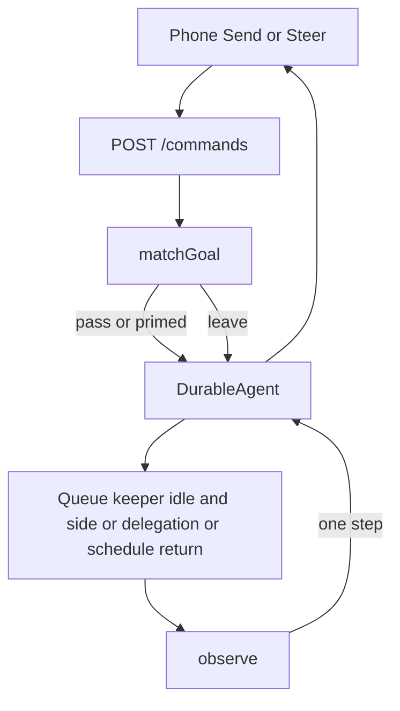

# Ralph v3 on the icedrop pi-durable app

**Synthesis decision:** base is Hatline (hats wear the root conversation). Grafted: the worn hat is derived from the transcript, not parsed out of the instructions string, and a settle waits while a delegation recorded for that conversation is still live. Rejected graft: deleting the Rust merge queue. The daemon does not land git branches.

Pinned app: `icedrop-labs/pi-durable` master `88f9fc38105aa1b70ca1b24c7f7c03a308f36e80`, which embeds `@earendil-works/pi-durable` 1.1.0. Ralph today: `integration/v3-prerelease` `a01826d`.

## Problem

Ralph's value is an enforced hat graph: one agent, one hat at a time, handoff through published topics, caps so a hat cannot thrash. On this branch `ralph run` does not enforce that graph. It spawns the `autoloop` binary. `crates/ralph-cli/src/autoloop_preset_gen.rs` writes triggers, publishes, instructions, and `concurrency` when it is above one. It does not write `default_publishes`, `max_activations`, `disallowed_tools`, or per-hat `timeout`. Each iteration is a fresh backend process. Rust selects the role. The backend runs a model. Those are two queues.

The interactive surface already exists, and it is not that loop. `icedrop-labs/pi-durable` is one daemon, one SQLite writer, one `DurableAgent`. The phone sends, steers, and stops. Side sessions fork at a settled tail and merge one model-visible `side.result`. `claude_code` and `subagent` take a project id. Schedules fire into a side run. `configure` on the wire is JSON-safe (`model`, `thinkingLevel`, `instructions`, `cwd`). A client cannot install a tool. `DurableAgent.abort()` calls `root.abort(context)` with no `{ background: true }`.

Hats are a policy over those mechanisms. A second durability store, a second protocol, or a selector outside the process that holds the sqlite diverges from `pi.inbox` the moment the phone steers.

## Constraints from the record

| | |
|---|---|
| Preserve | Ralph stays a thin coordination layer, not a platform. Issue [#256](https://github.com/mikeyobrien/ralph-orchestrator/issues/256) (closed 2026-06-21, not planned) rejected a git-as-message-bus protocol and named the then-current files as the durability model. Three days later [#342](https://github.com/mikeyobrien/ralph-orchestrator/issues/342) made `run_autoloop_engine` the sole engine. Treat #256 as "do not become a platform." Treat the cutover spec (`docs/superpowers/specs/2026-06-23-autoloop-cutover-design.md`, Chosen) as "do not embed a JS engine in Rust and do not rewrite the engine in Rust." One process owns storage. Phone Send versus Steer stays `whenBusy`. Ordinary abort stays ordinary abort. |
| Change | Hat policy moves into the icedrop daemon, beside the process that already resumes on boot. `.ralph/events.jsonl` is not the authority. It is already off the `ralph run` path (`EventLogger::enabled` is false in `crates/ralph-cli/src/main.rs`). |
| Avoid | The first commit of [PR #381](https://github.com/mikeyobrien/ralph-orchestrator/pull/381), `ba4e31d`. A Rust brain that selects hats while TypeScript only runs the model. A new daemon, a new protocol, a new sqlite. Hat lines stuffed into `projects.jsonl`. A watchdog timer inside the policy. |
| Risk | This environment could not `git clone` the private app (see below). `docs/projects-v2.md` and `docs/steer-arbiter.md` are not in the repo. Background `claude_code` survives ordinary abort. Ralph v3 depends on a private repository. |

Sources consulted: source control (PR #381 commits, cutover spec, `autoloop_preset_gen.rs`), GitHub issues #256 and #342–#347, Notion page "Pi-durable — durable agent daemon" (`3185a8e1-c613-81c0-8264-e0d4f0c8e4a3`), Slack `#ralph` (no thread discusses pi-durable or the v3 successor). Cloudflare observability, Sentry, and product analytics were not consulted. They are not this product's runtime.

## Usage

Three call sites, all inside the existing daemon. The phone keeps posting the commands it posts today. There is no new protocol variant.

Boot, next to the installs for `claude_code` and `subagent`. This is the only place a tool can appear.

```typescript
installEmit(registry);
```

The queue keeper's idle edge, and the paths that already record `side.merged`, a finished delegation, or a fired schedule. One call. It reads committed state itself.

```typescript
await onSettled(env, conversationId);
```

A root pipeline the person watches in the conversation they already have open:

1. The phone Sends "Add a header before the paragraph." The root is idle and no hat is wearing. `matchGoal` finds the planner, whose place is `root`. The route sets the instructions section, then the existing handler submits the person's text under the phone's `requestId`.
2. The planner calls `emit` with `plan.ready`. The tool returns `terminate: true`. It does not submit, configure, or fork.
3. The keeper idles and calls `onSettled`. `observe` sees that emit, sets the builder's instructions, and follow-ups one message whose `requestId` is `wake:<emitEntryId>:builder`. Same conversation, same provider session.
4. The builder emits `build.done`. The subscriber is a side hat of width 4. `onSettled` forks four sides at that settled entry. The root stays idle.
5. Each side emits `review.done` and, once its own delegations are idle, merges. When the fourth `side.merged` lands, the root wears the synthesizer, because its trigger is `{ on: "side.merged", hat: "reviewer", aggregate: "all" }`.
6. The synthesizer emits `loop.complete`. `onSettled` clears the instructions section. The next Send is a new goal.

`abort`, `/media`, and every other existing command hit the existing handler. Abort stays `DurableAgent.abort()` with no background flag.

A terminal, later, is a client of the same protocol the phone speaks. `ralph run` posts a submit and attaches to `GET /events`. It does not parse a hat and it does not open the sqlite.

## Shape

The room is the root conversation. A hat is a visit. A visit is a change of the instructions section in that room, or a walk out a door the building already has. There is no hallway: no job list, no topic bus, no hook that continues the turn, no hat field on `DurableAgent`.

Policy is two pure functions.

`matchGoal(rules, view)` runs on a Send that is not in the transcript yet. The room is busy, or a hat already wears an open chain: the result is `pass`, and the Send enters `pi.inbox` exactly as the phone asked. Otherwise it returns the one rule triggered by `human.goal`, either `prime` (a root hat) or `leave` (any other place).

`observe(rules, view)` runs on a healed view after a settle. It returns one step. `onSettled` applies that step and returns. It does not call itself. A second idle sees the new view.

`RootHat.place` is the literal `"root"`. The type has publishes, triggers, instructions, an optional default publish, and an optional activation cap. It has nowhere to put a model, a cwd, a tool ban, or a width. Those fields exist on `SideHat`. A delegation carries a project id. A schedule carries an opaque `when`.

Wearing a root hat calls `configure({ instructions })`. The stored string is the author's text. It is output. The worn hat is not parsed back out of it. `ViewReader` derives the worn hat from the last admitted wake or prime in the committed transcript (`requestId` `wake:<entryId>:<hatId>`, or the goal submit that primed the chain). A client that configures instructions is overwritten the next time `onSettled` wears that hat. The route does not refuse `whenBusy: "reject"`, model changes, or cwd changes. Those commands stay the app's.

The catalog of other hats is not a system section. A section that lists the graph asks the model to route, and a section that changes every turn breaks the prefix. The stable prefix is whatever the app already renders, including repo `AGENTS.md`. The variable suffix is the instructions section and the newest user message.

The first wear does not submit a second time. It returns `primed`, and the route admits the original Send. Later wears call follow-up with `whenBusy: "followUp"` fixed inside the port. The wake text is the topic and the payload. It does not repeat the instructions. Same hat, new topic: zero system entries, one new user message. Hat switch: one system entry whose changed key is `instructions`. Repeating `configure` with the identical string also appends nothing. Both are measured below.

Wake ids are minted by the daemon. Two overlapping keeper calls compute the same id from the same view and collapse, because `requestId` returns the existing submission. A client `requestId` that starts with `wake:` or `depart:` is rejected at the route, because a repeated id returns the existing submission even when the text differs. That is the only submit gate. It does not inspect `whenBusy`.

### What a leave is

Three methods, each an existing app API.

- `forkSide` forks inside the same harness sqlite, at the settled origin, create-or-return on `depart:<origin>:<hat>:<index>`. The overlay (instructions, optional model, cwd, `disallowedTools`) is applied in that fork, in process. It is not a wire `configure`. Width is `1` or `2..8`.
- `delegate` returns the app's delegation id. The child keeps the data dir `toolEnv` already pins. Hatline never opens that sqlite.
- `schedule` registers with the existing scheduler.

A side wears one hat. Its `onSettled` merges only when that conversation's delegation log shows no live worker. Otherwise it stays quiet. Chaining happens in the root, after `side.merged`. `Trigger` is a closed union: `human.goal`, an emit topic published by a root hat, `side.merged` of a named hat with aggregate `all` or `first`, `delegation.done`, `schedule.fired`. Aggregate `first` wakes the subscriber on the first settled child. The other children keep running. Nothing in this process calls `abort({ background: true })`.

The view has two slots, both derived. `tail` is the conversation's own latest outcome. `leaves` is the app's side, delegation, and schedule records for this chain, including a live-worker count taken from the delegation log the app already writes. A new emit outranks a satisfied leave. One step per idle. No stored queue.

`ViewReader.read` is the only constructor of a `HealedView`. It reads the committed harness view plus those app records. The phone's SSE reducer state is a different type and is not assignable to `HealedView`. Policy never folds a delta stream.

### The mouth

`installEmit` registers an extension named `hatline` with one tool, `emit`. The extension has no hooks, no sections, and no tasks. The topic must be one of the worn hat's publishes. Success returns `{ control: { terminate: true } }`, so the visit ends before the next hat's instructions are applied. The tool has no handle to `observe`, `followUp`, or the leave port.

`defaultPublishes` is applied by `observe` when a visit ends with no emit and no live worker. It is attributed to the assistant entry that stayed silent, so a retry does not invent a second wake. No synthetic tool call is written.

`maxActivations` counts wears and departures of that hat since the chain's human goal, derived from admitted wake ids and depart keys. Hitting the cap is `quiet`. A graph with no completion topic also carries a chain budget (a count of wakes since the goal). Two hats that trigger each other stop at the budget. There is no runtime timer. A deadline is a schedule hat with a `when` the existing scheduler understands.

### Where the rules live

Rules are hat YAML, loaded by the daemon. One authoring format. `projects.jsonl` stays the project registry (`name`, `cwd`, `rules`, `status`). A `hat` line in that file would be dropped: `docs/projects.md` says a line for an id with no complete record is ignored. `importHats` is offline: Ralph YAML in, `CheckedRules` out, no sqlite. `AGENTS.md` stays the repo guide the app already feeds the model.

| YAML | Rule |
|---|---|
| `triggers: ["task.start"]` or the loop `starting_event` | `{ on: "human.goal" }` on that hat. The phone's Send is the start. |
| `publishes`, `instructions`, `default_publishes`, `max_activations` | Copied. `default_publishes` must be one of `publishes`. |
| `concurrency` absent or `1`, and no model, cwd, or `disallowed_tools` | `place: "root"`. |
| `concurrency` from 2 to 8 | `place: "side"` with that width. |
| `disallowed_tools`, `cwd`, `model` | Forces `place: "side"` even at width 1. The overlay is in-process. |
| A root hat triggered by a topic that only a side publishes | Rewritten to `{ on: "side.merged", hat }`. |
| `aggregate.mode: wait_for_all` or `fail_fast` on the subscriber | `all` or `first` on that `side.merged` trigger. |
| `concurrency` and `aggregate` on the same hat | Import error. A worker fans out. A subscriber waits. |
| `aggregate.timeout`, hat `timeout` | Import error. A deadline is a schedule hat. |
| `backend`, `backend_args`, `scratchpad` | Import error. One root model through the app. Scratchpads are not a second transcript. |

`fail_fast` maps to aggregate `first`. Sibling sides are not aborted. The name in the rule is `first` so the type does not imply a kill.

```json
{"kind":"hat","id":"planner","place":"root","triggers":[{"on":"human.goal"}],"publishes":["plan.ready"],"instructions":"Write the plan. emit plan.ready. Stop."}
{"kind":"hat","id":"builder","place":"root","triggers":[{"on":"emit","topic":"plan.ready"}],"publishes":["build.done"],"defaultPublishes":"build.done","maxActivations":3,"instructions":"Implement the plan."}
{"kind":"hat","id":"reviewer","place":"side","width":4,"triggers":[{"on":"emit","topic":"build.done"}],"publishes":["review.done"],"instructions":"Review your file."}
{"kind":"hat","id":"synthesizer","place":"root","triggers":[{"on":"side.merged","hat":"reviewer","aggregate":"all"}],"publishes":["loop.complete"],"instructions":"Say what the reviews agreed."}
```

That JSON is the compiled form `checkRules` brands. It is not a second file the daemon watches.

### Reused, new, and what stays in Rust

Reused, unchanged as contracts:

- `packages/protocol` `Command` and `Event`. Wire configure stays JSON-safe. No new command variant. `SideOrigin` stays `schedule | delegation | manual`.
- `packages/client` SSE reducer. It still snapshot-heals. Hatline never reads it.
- `apps/server` `DurableAgent`: `GET /events`, `POST /commands`, `/media`, resume on boot, the queue keeper, side fork / `side.origin` / `side.result` / `side.merged`, ordinary `abort()`.
- `apps/mobile`: Send versus Steer, the conversation switcher, delegation cards.
- `packages/agent`: `claude_code`, `subagent`, `projects.jsonl`, schedules, decisions, `toolEnv`.

New, all inside that app, all in one process:

- `installEmit`, `onSettled`, `matchGoal`, `observe`.
- `ViewReader`, a derivation over committed records and the delegation log.
- `importHats` / `checkRules`, offline, one YAML format.
- One extension with one tool and no hooks.

Rust keeps git coordination the daemon does not do: worktrees, the merge queue, the loop lock, landing. Those files are not the hat authority and the hat path does not read them. A parallel checkout is a second registered project, which the app already supports. Deleting the merge queue was the other candidate's graft. It loses the only component that lands a finished worktree branch, and the daemon has no replacement. Hat YAML stays an authoring format `importHats` consumes. Rust does not keep a run path. `HatRegistry`, the event bus, preset generation, and `.ralph/events.jsonl` are not called by v3 `ralph run`. A Rust TTY that wants a live view subscribes to `GET /events` and posts `submit`. It does not open the sqlite.



## What PR #381 hand-rolled, and what replaces it

[PR #381](https://github.com/mikeyobrien/ralph-orchestrator/pull/381) has two commits on `docs/pi-durable-design`.

`ba4e31d` (`docs(design): v3 successor on pi-durable Harness`, 2026-10-11) adds `docs/design/pi-durable-harness.md`. The subject says pi-durable. The file does not contain the string `pi-durable`. The boundary it specifies is `pi --mode rpc` as a subprocess. The authority it specifies is `.ralph/events.jsonl`. It also specifies `.ralph/pi/session.json` for the session file path, a job record under `.ralph/pi/jobs/`, and one immediate re-execution of a running job after a crash. That is a second brain: Rust admits goals, selects hats, and retries; the subprocess only generates.

`72e8128` (`docs(design): successor targets pi-durable, not pi rpc`, 2026-10-11) rewrites the same path. The PR body says the first draft hand-rolled durability pi-durable already provides, and that a Rust orchestrator shelling out to `pi` per turn repeats the autoloop mistake. The revised note tells Ralph to open `@earendil-works/pi-durable`'s `Harness` and to keep hats, policy, and UX. It still sketches a fresh Node host spawned by the Rust binary, with its own `harness.sqlite`.

This design keeps the withdrawal and drops the fresh host. The host is the icedrop daemon that is already running. The replacements, all inside `@earendil-works/pi-durable` 1.1.0 as that daemon uses it:

| Hand-rolled in `ba4e31d` | Replacement |
|---|---|
| `.ralph/events.jsonl` as the log hats read | The harness transcript. `watchEvents` is commit-derived, snapshot-first, per conversation. |
| `.ralph/pi/session.json` | `ProviderDoc`, a persisted UUIDv7 `sessionId`, written by the harness. |
| `.ralph/pi/jobs/` plus a status machine | `pi.inbox` (`steer`, `followUp`, `reject`) and durable tasks with checkpoints. |
| One crash retry of the running job | `Harness.open` on the same sqlite, then `resume()`. `close()` writes no outcome for an in-flight invocation, so the next open continues it. |
| `pi --mode rpc` stdin/stdout | `POST /commands` and `GET /events` in `packages/protocol`. |

## How Rust talks to the runtime

There is no new bridge. The bridge is the app's protocol.

A Rust TTY is a client: HTTP `POST /commands` and an SSE `GET /events`, the same pair `packages/client` already speaks. It never links `node:sqlite`, never opens `harness.sqlite`, and never learns a hat type. Idempotency is the daemon's `requestId`, which only holds in the process that owns storage.

The cutover spec rejected embedding a JS engine in the Rust binary and rejected a Rust rewrite of the engine. A private JSON-line protocol to a sidecar spawned by `ralph run` is the shape `72e8128` still sketched. It is a second process beside the phone's daemon, a second sqlite, and two clients that can both admit a goal. Resume then depends on which process opens the file. The app already resumes on boot.

## Evidence

Each claim below was run in this session unless the line says it was read.

**The private app could not be cloned.** `gh repo view icedrop-labs/pi-durable` returned `GraphQL: Could not resolve to a Repository`. `git clone https://github.com/icedrop-labs/pi-durable.git` returned `Repository not found`. The token is the Cursor GitHub App installation. The same repository was readable through the GitHub connector: `get_commit` on master returned `88f9fc38105aa1b70ca1b24c7f7c03a308f36e80` ("Refresh the README for the side-session architecture", 2026-10-12). File reads used that API. `docs/projects-v2.md` and `docs/steer-arbiter.md` returned 404. `docs/monorepo.md` names both as future consumers of the side-session API, not as documents that exist.

**`DurableAgent.abort` does not cross background.** `packages/agent/src/agent.ts` at blob `08adf59c…` (that commit's tree): `async abort(): Promise<void> { await this.root.abort(this.context); }`. No options argument.

**The seam prototype ran against the published library the app pins.** From `prototypes/v3-hat-seam`, after `npm install` of `@earendil-works/pi-durable@1.1.0`, `@earendil-works/pi-ai@1.1.0`, and `@earendil-works/chord@1.1.0`:

```bash
cd prototypes/v3-hat-seam && npm install && npm run seam
```

`node seam.mjs` exited 0. `ok` is `true`. The script fails if any invariant below breaks. Measured values:

| Claim | Result |
|---|---|
| A hat switch appends one `pi.system` entry, and its only section key is `instructions` | `hatSwitchDeltaKeys = [["instructions"]]`. The rendered text is wrapped by the harness: `<instructions>…</instructions>`. The catalog section on the earlier entry is unchanged. |
| A later wake of the same hat, with no configure, appends no system entry | `sameHatAddedSystemEntries = 0` |
| `configure({ instructions })` with the identical string, then a new submit, appends no system entry | `repeatConfigureAddedSystemEntries = 0` |
| A submit with `whenBusy: "steer"` while a run is held queues in `pi.inbox` | `inbox.whileBusy = [{ id: 10, mode: "steer" }]`, then `steer.status = done` after release |
| `whenBusy: "reject"` while busy refuses | throws `ConversationBusy` |
| A repeated `requestId` returns the settled submission, including after a different text | `requestId.dedupesSettled = { first: 8, replay: 8, equal: true }`. Replay of `wake:plan.ready` with different text returned submission `17` |
| Reopening the same sqlite and submitting `greeting-1` again does not grow the transcript | `sameSubmission: true`, kinds before and after `[pi.user, pi.assistant]`, `entryCountUnchanged: true` |

The prototype's `route()` and `handle()` are the policy and the command union. `handle` only calls `submit`, `configure`, and `abort`. It does not import a storage constructor. The host opens `Harness` once. That split is the seam. It is not a second daemon: the host in the test is a stand-in for `DurableAgent`, which already owns the open.

What this run did not measure: `emit` returning `terminate: true` (the scripted model ended its own turn), `abort({ background: true })` against a `claude_code` task, and create-or-return on a real `forkSide` key. Those stay open.

## Tradeoffs

A visit ends at `emit`. The next hat starts on a later idle, as a new run. That gap is what keeps a hat switch from landing underneath tool calls the model already issued. pi-durable applies a cwd or extension change to calls already in flight. Ending the visit first is the cache rule and the correctness rule at the same time.

Root hats share the root tool set. Banning `bash`, pinning a cwd, or changing model costs a side conversation and a cold provider session. That cost is visible on the rule as `place: "side"`.

Aggregate `first` and an ordinary abort leave sibling work running, including background `claude_code`. The harness already behaves this way. A later root visit can tell the model to stop workers. Workers that ignore the context signal are a bug in that tool, not a job table this policy should grow.

One step per idle means a person who talks during a fan-out postpones the synthesizer until the next quiet moment. The leave records stay in the view. The person is not talked over by a steer from the policy.

`importHats` rewrites a root trigger on a side-only topic into `side.merged`. A literal reading of old YAML would wait for an emit that happens in another conversation and never arrives. `checkRules` rejects the unrewritten form so a hand-written compiled rule cannot sneak it back in.

The reader is new code. It is the one place that understands transcript entries and the app's side, delegation, and schedule records. If it derives the wrong tail, the pure function will do the wrong thing faithfully.

Git coordination stays in Rust. That is a second set of files (`.ralph/merge-queue.jsonl`, the loop lock). They coordinate checkouts, not hats. The hat path does not read them. Folding git landing into the daemon would make the daemon a platform.

## Alternatives

**A loop is a side session, and hats rotate there** (the other arena candidate). The person asks in their thread, the agent starts a loop beside it, and one `side.result` comes back at the end. This keeps the root cache warm and gives every hat a fresh-ish transcript. It loses the conversation the person is already in: Send and Steer on the thread they opened do not wear the hat, and each activation reconfigures model and tools inside the loop, which is the cache break the root-hat type exists to forbid. It also adds `SideOrigin` `"loop"`, three entry kinds (`ralph.loop`, `ralph.publish`, `ralph.hat`), and a driver that interprets steps. That driver is a second loop living next to the queue keeper. The pure `next()` and the "wait while delegations are live" rule were the parts worth keeping. The second is grafted, as a count on the view, not as a new entry kind.

**Routing hooks on the generation** (`onYield`, `afterTools`, an extension that configures the next hat and continues the run). One run for the whole pipeline. A configure during a round reaches tool calls already issued. The hook's continue and the phone's Steer share one inbox with no type that reserves Steer for the phone. The extension becomes a second event loop that happens to live in-process.

**A Node host spawned by the Rust binary**, with a private JSON-line protocol and its own `harness.sqlite`. This is the shape left in `72e8128`. A second process beside the app's daemon, a second protocol beside `packages/protocol`, a second sqlite beside the phone's conversation.

**Rust selects the hat and TypeScript runs the model.** The autoloop split, and the shape of `ba4e31d`. Two queues, a log that is not the transcript, and a crash path beside `Harness.open` plus `resume()`.

**The phone's SSE reducer runs `observe` and posts the next command.** The pipeline stops when the phone sleeps. Two attached clients double-wake. A client still cannot install `emit`. The stream has no sequence numbers. The reducer heals by replacing state with a snapshot.

**Every hat is a side conversation.** Honors "long work leaves" and drops "wake in the same root when that is cache-safe." A cold provider session per persona. The phone's one conversation stops being where the goal is pursued.

**Embed a JS engine in Rust, or rewrite the harness in Rust.** The cutover spec already rejected both.

## Open questions

1. Does the side record already have a stable key we can use as `depart:<origin>:<hat>:<index>`, or does `forkSide` recover the index from `side.origin`? The port requires create-or-return. The field has to be one the app already stores.
2. Does the queue keeper run when a side conversation goes idle, or only when the root does? `onSettled` is specified for both.
3. After a leaving goal is noted with a `write` submission, is that write deduped by `requestId` the same way an `input` submission is? The retry of a leaving goal depends on that. The seam measured dedupe for `input` only.
4. Is the live-worker count on the delegation log keyed by the conversation that started the worker, so a side can see its own children without reading another conversation's task rows?
5. A Send while a hat wears an open chain is a follow-up to that hat, including when the root is idle between visits. A new goal starts when the chain is `complete` or no hat is wearing. Abort skips the tail and still lets leaves finish. Is abort-plus-a-new-Send the abandon gesture, or does the phone need an explicit "new goal" that clears instructions without aborting leaves?

## Next implementation step

One faux-provider test inside `icedrop-labs/pi-durable`, two root hats, no sides. The script in `prototypes/v3-hat-seam/seam.mjs` is the library-level version of that test. The app-level version uses the app's command handler and the app's sqlite:

- Boot installs `emit` on the same registry as the other tools. The extension's hook list is empty.
- A phone Send on an idle root with no hat primes the planner and admits one submit. The first model-visible user message is the person's text.
- The planner's emit terminates the run. `onSettled` wears the builder. The new `pi.system` entry touches `instructions` and leaves the rest of the prefix in place. A second wake of the builder adds no system entry. Repeating the same instructions adds none either.
- Repeating the wake `requestId` returns the same submission id.
- A Steer during the planner's run is admitted with `whenBusy: "steer"` and does not change instructions.
- Killing the process after the emit and reopening via the app's existing resume wears the builder once.

Side forks are the step after that test is green.
